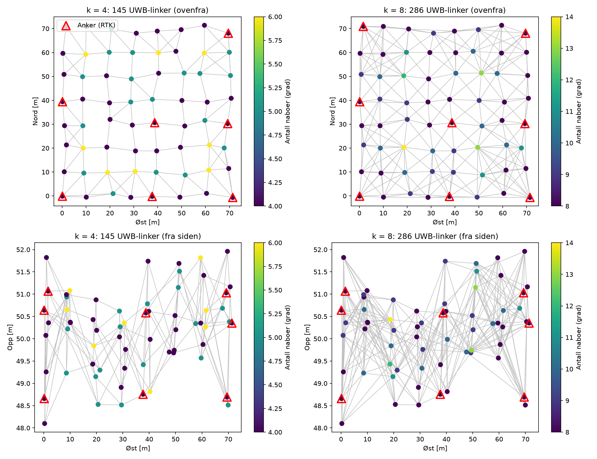

# swarm-relative-positioning
ankre   k  konv.  abs RMS [m]  rel RMS [m]   ANEES
    1   4   0/10            –            –       –
    2   4   0/10            –            –       –
    4   4   0/10            –            –       –
    8   4   0/10            –            –       –
   16   4   1/10        0.187        0.183    1.09
    1   6   4/10        5.803        0.190   39.57
    2   6   2/10        3.815        0.211   26.77
    4   6   5/10        0.205        0.163    1.03
    8   6   4/10        0.156        0.135    1.02
   16   6  10/10        0.098        0.094    1.00
    1   8   6/10        6.256        0.119   47.75
    2   8   9/10        1.356        0.115    1.20
    4   8   7/10        0.109        0.093    0.91
    8   8  10/10        0.094        0.088    1.01
   16   8  10/10        0.075        0.074    1.00

